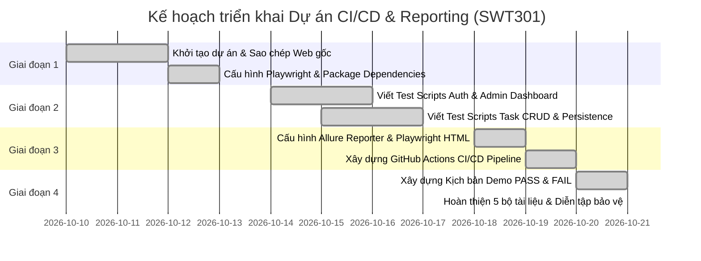

# 👥 BẢNG PHÂN CHIA CÔNG VIỆC NHÓM (TEAM TASKS ALLOCATION)

**Dự án:** Student Task Manager – CI/CD & Reporting  
**Học phần:** SWT301 – Software Testing  
**Giảng viên hướng dẫn:** Bộ môn Kỹ thuật Phần mềm – Đại học FPT  
**Quy mô nhóm:** 4 Thành viên  
**Nguyên tắc phân bổ:** Khối lượng công việc và trách nhiệm được phân bổ đồng đều (25% mỗi thành viên), đảm bảo tính chuyên môn hóa và phối hợp chặt chẽ.

---

## 📊 1. Bảng phân công tổng quan và Tỷ lệ đóng góp

| STT | Họ và tên | Mã sinh viên | Vai trò dự án | Nhiệm vụ chính phụ trách | Đóng góp |
| :---: | :--- | :---: | :--- | :--- | :---: |
| **1** | **Nguyễn Văn An** *(Nhóm trưởng)* | SE170001 | CI/CD & Infrastructure Engineer | Thiết lập dự án, cấu hình GitHub Actions CI/CD Pipeline, tích hợp Allure Playwright & Allure CLI, tối ưu cấu hình `playwright.config.js` | **25%** |
| **2** | **Trần Thị Bích** | SE170002 | Test Automation Engineer (Auth & Admin) | Thiết kế & lập trình E2E test scripts cho Module Xác thực (Login/Logout sinh viên & admin) và Module Phân quyền Admin Dashboard | **25%** |
| **3** | **Lê Hoàng Cường** | SE170003 | Test Automation Engineer (Task CRUD) | Thiết kế & lập trình E2E test scripts cho Module Quản lý bài tập (Task CRUD, ràng buộc deadline, lọc, tìm kiếm) và Lưu trữ dữ liệu | **25%** |
| **4** | **Phạm Minh Đức** | SE170004 | Demo & QA Documentation Specialist | Thiết kế kịch bản Demo trực quan (PASS slowMo banner & Controlled FAIL), xuất báo cáo Allure/HTML, biên soạn trọn bộ tài liệu kỹ thuật | **25%** |

---

## 📝 2. Chi tiết phân công công việc theo từng thành viên

### 👨‍💻 Thành viên 1: Nguyễn Văn An (Nhóm trưởng / CI/CD & Infrastructure Engineer)
- **Mục tiêu chính:** Đảm bảo hệ thống kiểm thử tự động vận hành thông suốt trên cả môi trường máy cục bộ (Local) và môi trường tích hợp liên tục (CI/CD GitHub Actions).
- **Các nhiệm vụ cụ thể:**
  1. Khởi tạo cấu trúc dự án độc lập, kiểm tra và bảo đảm giữ nguyên mã nguồn website gốc (`src/` và `server.js`).
  2. Thiết lập `package.json`, cấu hình các dependencies (`@playwright/test`, `allure-playwright`, `allure-commandline`) và các npm scripts (`test`, `allure:generate`, `allure:open`, `demo:pass`, `demo:fail`, `clean`).
  3. Cấu hình file `playwright.config.js`: tích hợp đồng thời 3 reporters (`list`, `html`, `allure-playwright`), cấu hình webServer tự khởi động cổng 3000, bật tự động thu thập trace/screenshot/video khi test thất bại.
  4. Xây dựng workflow GitHub Actions hoàn chỉnh tại [`.github/workflows/ci.yml`](file:///.github/workflows/ci.yml):
     - Kích hoạt tự động khi `push` và `pull_request` vào nhánh chính.
     - Khởi tạo môi trường Ubuntu Runner, cài đặt Node.js 20 và Java JDK 17 (Temurin).
     - Cài đặt trình duyệt Playwright Chromium kèm dependencies hệ thống.
     - Thực thi test suite, biên dịch Allure Static Report.
     - Cấu hình lưu trữ 4 gói artifacts an toàn với cơ chế `if: always()`.
- **Sản phẩm bàn giao:**
  - File [`.github/workflows/ci.yml`](file:///.github/workflows/ci.yml)
  - File [`playwright.config.js`](file:///playwright.config.js)
  - File [`package.json`](file:///package.json)
  - File [`.gitignore`](file:///.gitignore)

---

### 👩‍💻 Thành viên 2: Trần Thị Bích (Test Automation Engineer - Module Auth & Admin)
- **Mục tiêu chính:** Đảm bảo tính chính xác và an toàn tuyệt đối cho các chức năng xác thực người dùng và phân quyền hệ thống.
- **Các nhiệm vụ cụ thể:**
  1. Phân tích yêu cầu và viết kịch bản kiểm thử E2E cho Module Xác thực (`tests/auth.spec.js`):
     - `TC_AUTH_01`: Đăng nhập sinh viên thành công với tài khoản chuẩn.
     - `TC_AUTH_02`: Báo lỗi validation khi để trống thông tin.
     - `TC_AUTH_03`: Báo lỗi khi sai mật khẩu.
     - `TC_AUTH_04`: Báo lỗi khi tài khoản không tồn tại.
     - `TC_AUTH_05`: Đăng xuất và dọn dẹp phiên làm việc.
  2. Phân tích và viết kịch bản kiểm thử E2E cho Module Phân quyền Admin Dashboard (`tests/admin.spec.js`):
     - `TC_ADMIN_01`: Đăng nhập tài khoản Admin mở đúng Admin Dashboard.
     - `TC_ADMIN_02`: Kiểm tra tính toán số liệu thống kê toàn trường (sinh viên, tổng bài tập, bài hoàn thành, bài đang chờ).
     - `TC_ADMIN_03`: Hiển thị danh sách sinh viên kèm tiến độ học tập.
     - `TC_ADMIN_04`: Lựa chọn sinh viên xem chi tiết danh sách bài tập.
     - `TC_ADMIN_05`: Lọc bài tập của sinh viên theo trạng thái hoàn thành/đang chờ.
     - `TC_ADMIN_06`: Kiểm tra phân quyền chặt chẽ (Sinh viên không mở được giao diện Admin).
     - `TC_ADMIN_07`: Đăng xuất Admin an toàn.
  3. Tối ưu bộ chọn Playwright (Locator) chuẩn theo `data-testid` để test scripts chạy ổn định và không phụ thuộc CSS selector dễ gãy.
- **Sản phẩm bàn giao:**
  - File [`tests/auth.spec.js`](file:///tests/auth.spec.js) (5 test cases)
  - File [`tests/admin.spec.js`](file:///tests/admin.spec.js) (7 test cases)

---

### 👨‍💻 Thành viên 3: Lê Hoàng Cường (Test Automation Engineer - Task CRUD & Persistence)
- **Mục tiêu chính:** Kiểm thử toàn diện chức năng nghiệp vụ trọng tâm của ứng dụng: quản lý bài tập học tập và độ bền dữ liệu.
- **Các nhiệm vụ cụ thể:**
  1. Phân tích và viết kịch bản kiểm thử E2E cho Module Quản lý bài tập (`tests/tasks.spec.js`):
     - `TC_TASK_01`: Kiểm tra danh sách bài tập ban đầu và các thẻ số liệu thống kê.
     - `TC_TASK_02`: Thêm bài tập mới với đầy đủ thông tin (tiêu đề, môn học, độ ưu tiên, hạn nộp tương lai, ghi chú).
     - `TC_TASK_03`: Bắt lỗi để trống tiêu đề bài tập (form validation).
     - `TC_TASK_03B`: Kiểm tra ràng buộc hạn nộp (không cho phép chọn ngày trong quá khứ).
     - `TC_TASK_03C`: Kiểm tra giá trị biên hạn nộp (cho phép chọn ngày hiện tại).
     - `TC_TASK_04`: Đánh dấu bài tập hoàn thành (cập nhật số liệu thống kê và gạch ngang tiêu đề).
     - `TC_TASK_05`: Bỏ đánh dấu hoàn thành (chuyển về trạng thái Đang chờ).
     - `TC_TASK_06`: Xóa bài tập kèm thông báo phản hồi Toast.
     - `TC_TASK_07`: Lọc bài tập theo trạng thái Đang chờ / Đã hoàn thành / Tất cả.
     - `TC_TASK_08`: Tìm kiếm theo từ khóa tên bài tập và kiểm tra giao diện Empty State.
  2. Phân tích và viết kịch bản kiểm thử Độ bền dữ liệu (`tests/persistence.spec.js`):
     - `TC_PERSIST_01`: Duy trì phiên đăng nhập và dữ liệu sau khi F5 tải lại trang.
- **Sản phẩm bàn giao:**
  - File [`tests/tasks.spec.js`](file:///tests/tasks.spec.js) (10 test cases)
  - File [`tests/persistence.spec.js`](file:///tests/persistence.spec.js) (1 test case)

---

### 👨‍💻 Thành viên 4: Phạm Minh Đức (Demo & QA Documentation Specialist)
- **Mục tiêu chính:** Xây dựng kịch bản trình diễn ấn tượng, quản lý xuất báo cáo trực quan và biên soạn trọn bộ tài liệu kỹ thuật đạt chuẩn môn học.
- **Các nhiệm vụ cụ thể:**
  1. Xây dựng kịch bản Demo PASS trực quan ([`demo.js`](file:///demo.js)):
     - Chạy trình duyệt Headed với chế độ chuyển động chậm (`slowMo: 300ms`).
     - Tự động hiển thị thanh thông báo tiến trình (Banner) bằng Tiếng Việt ngay dưới chân trang.
     - Đi qua toàn bộ luồng nghiệp vụ Sinh viên và Admin, giữ mở trình duyệt để Giảng viên quan sát.
  2. Xây dựng kịch bản Demo Bắt lỗi có kiểm soát ([`demo-failure.js`](file:///demo-failure.js) & [`tests/demo_failure_report.spec.js`](file:///tests/demo_failure_report.spec.js)):
     - Tạo kịch bản so khớp sai có kiểm soát để chứng minh cơ chế bắt lỗi của Playwright.
     - Tự động lưu ảnh chụp màn hình lỗi, video, trace và cập nhật Allure Report FAILED.
     - Đảm bảo cơ chế cô lập: Không ảnh hưởng đến bộ test chính và khôi phục 100% PASS tức thì.
  3. Xuất và kiểm chứng báo cáo Allure Report & Playwright HTML Report.
  4. Biên tập trọn bộ 5 tài liệu Markdown kỹ thuật:
     - [`README.md`](file:///README.md): Hướng dẫn tổng quan và hướng dẫn vận hành.
     - [`TEST_CASES.md`](file:///TEST_CASES.md): Đặc tả 24 ca kiểm thử chi tiết.
     - [`TEAM_TASKS.md`](file:///TEAM_TASKS.md): Bảng phân công công việc và đóng góp.
     - [`DEMO_GUIDE.md`](file:///DEMO_GUIDE.md): Kịch bản thuyết trình bảo vệ trước Giảng viên.
     - [`TEST_REPORT.md`](file:///TEST_REPORT.md): Báo cáo kết quả kiểm thử chính thức.
- **Sản phẩm bàn giao:**
  - File [`demo.js`](file:///demo.js)
  - File [`demo-failure.js`](file:///demo-failure.js)
  - File [`tests/demo_failure_report.spec.js`](file:///tests/demo_failure_report.spec.js)
  - Trọn bộ 5 file tài liệu Markdown.

---

## 📈 3. Kế hoạch triển khai theo các giai đoạn (Project Timeline)

---

## 🧭 4. Ma trận trách nhiệm RACI (RACI Matrix)

*Quy ước:*
- **R (Responsible):** Người trực tiếp thực hiện công việc.
- **A (Accountable):** Người chịu trách nhiệm phê duyệt cuối cùng về chất lượng.
- **C (Consulted):** Người được tham vấn ý kiến chuyên môn.
- **I (Informed):** Người được thông báo kết quả.

| Công việc / Hạng mục bàn giao | Nguyễn Văn An (TV1) | Trần Thị Bích (TV2) | Lê Hoàng Cường (TV3) | Phạm Minh Đức (TV4) |
| :--- | :---: | :---: | :---: | :---: |
| Sao chép & bảo toàn mã nguồn gốc | **A / R** | I | I | C |
| Cấu hình `playwright.config.js` | **A / R** | C | C | C |
| Phát triển test suite `auth.spec.js` | C | **A / R** | I | I |
| Phát triển test suite `admin.spec.js` | C | **A / R** | I | I |
| Phát triển test suite `tasks.spec.js` | I | I | **A / R** | C |
| Phát triển test suite `persistence.spec.js` | I | I | **A / R** | C |
| Xây dựng GitHub Actions Pipeline (`ci.yml`) | **A / R** | C | C | I |
| Tích hợp Allure Report & Playwright Report | **A / R** | I | I | C |
| Xây dựng kịch bản Demo PASS trực quan | C | C | C | **A / R** |
| Xây dựng kịch bản Demo FAIL có kiểm soát | C | I | I | **A / R** |
| Biên soạn bộ 5 tài liệu kỹ thuật | C | C | C | **A / R** |
| Diễn tập bảo vệ đồ án trước Giảng viên | **A** | **R** | **R** | **R** |

---

## 🏆 5. Đánh giá hoàn thành và Cam kết thành viên

Cả 4 thành viên trong nhóm xác nhận:
1. Đã hoàn thành 100% các hạng mục công việc được phân công đúng thời hạn.
2. Bộ kiểm thử tự động đã được kiểm chứng độc lập trên môi trường máy cá nhân và đường ống CI/CD.
3. Không làm thay đổi hay ảnh hưởng đến dự án gốc và giữ nguyên vẹn 100% giao diện website gốc.
4. Sẵn sàng tham gia thuyết trình và trả lời chất vấn của Giảng viên trong buổi bảo vệ môn học SWT301.
